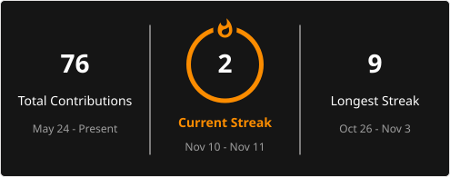

# lapsecoder — GitHub Profile

> Hi, I'm Ahmed.
> AIML Developer in Progress.
> Python Developer.
> Open Source Contributor.
> Building Intelligent Systems.

Building intelligent systems, experimenting with machine learning, and contributing to open source.

---

## About Me

- Computer Science Diploma student, specializing in AIML
- Python developer working on practical software and ML projects
- Interested in machine learning, deep learning, and open-source development
- Currently building and refining tools that make machine learning more usable

---

## Tech Stack

### Languages

### Frameworks and tools

---

## Featured Projects

### WriteTrace

A machine-generated writing forensics system using a genuinely trained and evaluated supervised machine learning model.

- Repository: [lapsecoder/WriteTrace](https://github.com/lapsecoder/WriteTrace)
- Live demo: [WriteTrace](https://writetrace-nine.vercel.app/)

---

### MovieMind

A machine learning-powered movie recommendation system.

- Repository: [lapsecoder/MovieMind](https://github.com/lapsecoder/MovieMind)
- Live demo: [MovieMind](https://movie-mind-liart.vercel.app/)

---

### ResumeForge

An AI-powered resume analysis and optimization platform featuring supervised machine learning.

- Repository: [lapsecoder/ResumeForge](https://github.com/lapsecoder/ResumeForge)
- Live demo: [ResumeForge](https://resume-forge-one-zeta.vercel.app/)

---

## GitHub Stats

---

## Contribution Activity

---

## Contact

---

_Profile README maintained for lapsecoder._
